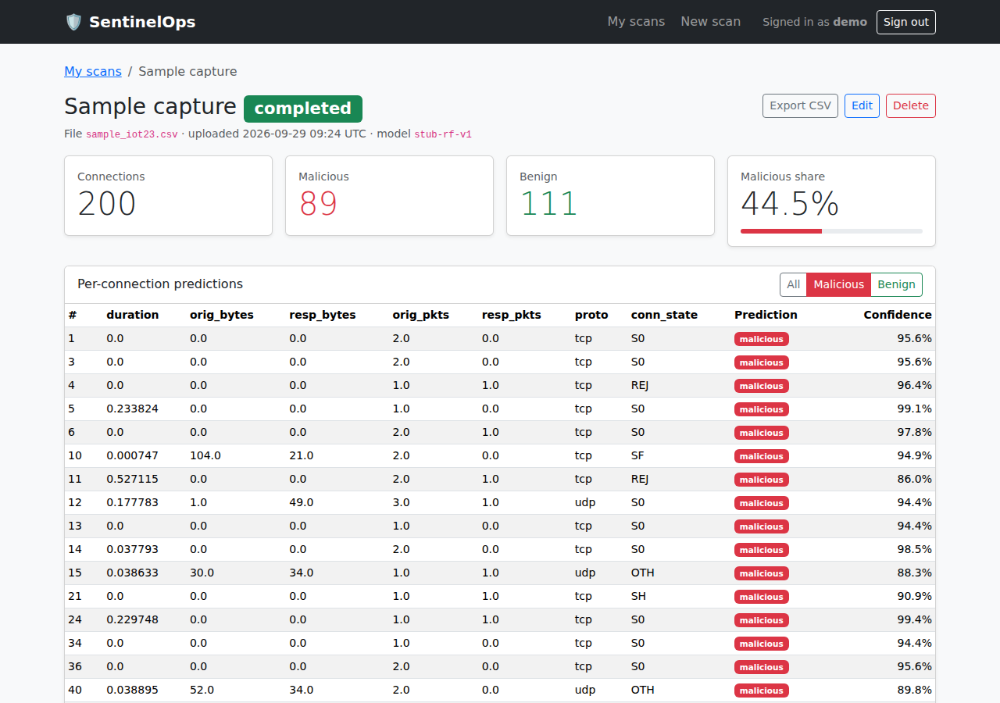

# SentinelOps

**Design and implementation of an end-to-end DevSecOps pipeline for a cloud-native IoT threat-detection service.**

SentinelOps is a small Flask web service. Users sign in, upload IoT network-traffic
captures (IoT-23 / Zeek `conn.log` style CSV), get a malicious/benign prediction
for every connection from a scikit-learn model, and manage their saved scan reports.
The app is deliberately small. Most of the project lives in the DevOps pipeline
built around it (Jenkins, Docker, Kubernetes, Ansible, Terraform, Prometheus/Grafana,
ELK, SonarQube, ArgoCD).

> **Status:** Phase 1 (application) and Phase 2 (Docker, Docker Compose, Jenkins CI) complete. See the [roadmap](#roadmap).



## Features

| Area | What's there |
|---|---|
| Auth | Register / login / logout (Flask-Login), scrypt-hashed passwords, CSRF-protected forms, safe `next` redirects |
| Scans (CRUD) | Upload CSV → scan, list (paginated), detail with per-row predictions and label filter, rename / notes, delete, export results as CSV |
| REST API | `/api/v1` mirrors the CRUD, returns JSON, uses bearer tokens and proper status codes (200/201/204/400/401/404/405/409/413/415/422/500) |
| Validation | Upload size limit, `.csv` only, UTF-8, required columns, numeric checks with line numbers, row limit |
| Errors | Centralised: JSON errors for `/api/*`, friendly HTML pages for the browser, no stack traces leaked |
| ML | `Predictor` interface in `app/ml/`, ships a stub RandomForest trained on synthetic IoT-23-style data. The real model drops in as `models/model.joblib` |
| Ops | `/healthz` (liveness), `/readyz` (DB + model readiness), `/metrics` (Prometheus), JSON logs to stdout with request ids, 12-factor config |
| Tests | 147 pytest tests covering auth, CRUD, API, validation, predictor, ops and migrations, ~98 % coverage |

## Quick start (local)

Requirements: **Python 3.11+** and git. To run everything in containers instead, see [Run with Docker Compose](#run-with-docker-compose-app--postgresql).

```bash
git clone https://github.com/<your-org>/sentinelops.git
cd sentinelops

python -m venv .venv
source .venv/bin/activate            # Windows: .venv\Scripts\activate
pip install -r requirements-dev.txt

cp .env.example .env                 # then set SECRET_KEY (see below)
python -c "import secrets; print(secrets.token_hex(32))"   # paste into .env

flask db upgrade                     # creates instance/sentinelops.db (SQLite)
flask run                            # http://127.0.0.1:5000
```

Register an account, click **New scan**, and upload
[`app/static/samples/sample_iot23.csv`](app/static/samples/sample_iot23.csv)
(also downloadable from the upload page).

For auto-reload while developing, run `flask run --debug`. Set `DEBUG_METRICS=1`
(already in `.env.example`) to keep `/metrics` available in debug mode.

## Run with Docker Compose (app + PostgreSQL)

Requirements: Docker Desktop (Windows/macOS) or Docker Engine + Compose v2.

```bash
cp .env.example .env     # Windows: copy .env.example .env
# edit .env: set SECRET_KEY and POSTGRES_PASSWORD (letters and digits only)
docker compose up -d --build
docker compose ps        # app should be "healthy"
```

Open http://localhost:8000. Useful commands:

```bash
docker compose logs -f app                     # JSON logs
curl http://localhost:8000/readyz              # DB + model check
docker compose exec db psql -U sentinel -d sentinelops -c "select count(*) from scans;"
docker compose down                            # stop (data kept in the pgdata volume)
docker compose down -v                         # stop and delete the database
```

What's inside:

| Piece | Details |
|---|---|
| `Dockerfile` | Multi-stage build on `python:3.11-slim`, dependencies in a virtualenv, no build tools in the final image, runs as non-root UID 10001, `HEALTHCHECK` on `/healthz`, OCI labels with version and git SHA |
| `docker/entrypoint.sh` | Runs `flask db upgrade` (with retries) and then starts gunicorn. `RUN_MIGRATIONS=false` disables it |
| `docker/gunicorn.conf.py` | 1 process × 4 threads (`gthread`), JSON logs, env-tunable. Scale with more containers/pods so each one exposes its own `/metrics` |
| `docker-compose.yml` | `app` + `postgres:16-alpine` with healthchecks and `depends_on: service_healthy`, named volume, DB not exposed to the host, app container read-only with all capabilities dropped and `no-new-privileges` |

## Continuous integration (Jenkins)

`Jenkinsfile` defines the pipeline: **Checkout → Install → Test (JUnit + coverage) →
Build image → Smoke test → Package → Push to Docker Hub** (main/develop). Jenkins
itself runs in Docker and is configured as code. A multibranch job builds every
push to every branch. Setup steps are in [jenkins/README.md](jenkins/README.md):

```bash
cd jenkins && cp .env.example .env   # set JENKINS_ADMIN_PASSWORD
docker compose up -d --build         # http://localhost:8080
```

## Configuration

All configuration comes from environment variables (or `.env` for local dev).
There are no secrets in the code.

| Variable | Default | Purpose |
|---|---|---|
| `APP_ENV` | `development` | `development`, `testing` or `production` |
| `SECRET_KEY` | *(random, dev only)* | Session/token signing key. **Required in production**; the app refuses to start without it |
| `DATABASE_URL` | `sqlite:///instance/sentinelops.db` | SQLAlchemy URL, e.g. `postgresql://user:pass@db:5432/sentinelops` |
| `MAX_UPLOAD_MB` | `5` | Upload size limit (HTTP 413 above it) |
| `MAX_CSV_ROWS` | `20000` | Max data rows per CSV |
| `MODEL_PATH` | `models/model.joblib` | Model file to load |
| `MODEL_SHA256` | *(unset)* | If set, refuse to load a model whose SHA-256 differs |
| `MODEL_FALLBACK_STUB` | `true` (`false` in production) | Train an in-memory stub model if `MODEL_PATH` is missing |
| `API_TOKEN_TTL_SECONDS` | `3600` | Bearer-token lifetime |
| `LOG_LEVEL` | `INFO` | Root log level |
| `SESSION_COOKIE_SECURE` | `false` (`true` in production) | Send cookies only over HTTPS |
| `APP_VERSION` | package version | Reported by `/healthz` and in metrics (the image build sets it to the git SHA) |
| `RUN_MIGRATIONS` | `true` | Container only: run `flask db upgrade` before starting |
| `GUNICORN_WORKERS` / `GUNICORN_THREADS` | `1` / `4` | Container only: gunicorn processes and threads |
| `POSTGRES_USER` / `POSTGRES_PASSWORD` / `POSTGRES_DB` | `sentinel` / – / `sentinelops` | Docker Compose database settings |

## Running the tests

```bash
pytest                                              # all tests
pytest --cov=app --cov-report=term-missing          # with coverage in the terminal
pytest --cov=app --cov-report=xml --cov-report=html # coverage.xml (Jenkins/SonarQube) + htmlcov/
```

Tests use an in-memory SQLite database and a stub model trained once per session,
so they need no external services. The build fails if coverage drops below 85 %.

## REST API

Base URL: `/api/v1`. Authenticate with `Authorization: Bearer <token>`.
The full endpoint reference is in [docs/api.md](docs/api.md).

```bash
BASE=http://127.0.0.1:5000/api/v1

# 1. register (once) and get a token
curl -s -X POST $BASE/auth/register -H 'Content-Type: application/json' \
     -d '{"username":"demo","email":"demo@example.com","password":"demo-pass-123"}'
TOKEN=$(curl -s -X POST $BASE/auth/token -H 'Content-Type: application/json' \
     -d '{"username":"demo","password":"demo-pass-123"}' | python -c 'import sys,json;print(json.load(sys.stdin)["access_token"])')

# 2. upload a CSV -> 201 Created + Location header
curl -s -X POST $BASE/scans -H "Authorization: Bearer $TOKEN" \
     -F file=@app/static/samples/sample_iot23.csv -F name="Lab capture"

# 3. list, read, results, update, delete
curl -s $BASE/scans -H "Authorization: Bearer $TOKEN"
curl -s "$BASE/scans/1/results?label=malicious&per_page=10" -H "Authorization: Bearer $TOKEN"
curl -s -X PATCH $BASE/scans/1 -H "Authorization: Bearer $TOKEN" \
     -H 'Content-Type: application/json' -d '{"notes":"reviewed"}'
curl -s -X DELETE $BASE/scans/1 -H "Authorization: Bearer $TOKEN" -o /dev/null -w '%{http_code}\n'   # 204
```

Errors always look like:

```json
{"error": {"status": 422, "type": "validation_error",
           "message": "The CSV is missing required columns: conn_state",
           "details": {"missing_columns": ["conn_state"], "required_columns": ["duration", "..."]}},
 "request_id": "5b0c..."}
```

## CSV format

The CSV needs these columns (Zeek `conn.log` / IoT-23 names, case-insensitive, any order):

`duration, orig_bytes, resp_bytes, orig_pkts, resp_pkts, proto, conn_state`

Extra columns (`ts`, `uid`, `id.orig_h`, `label`, …) are ignored. Zeek's `-`
means an empty value and is read as 0. The delimiter (`,` `;` `|` or tab) is
auto-detected.

## Operations endpoints

| Endpoint | Use | Response |
|---|---|---|
| `GET /healthz` | Kubernetes liveness probe | `200 {"status":"ok"}` whenever the process serves requests |
| `GET /readyz` | Kubernetes readiness probe | `200` when the DB answers `SELECT 1` and the model is loaded, otherwise `503` with per-check detail |
| `GET /metrics` | Prometheus scrape target | Prometheus text format |

Metrics exported:

- `flask_http_request_total`, `flask_http_request_duration_seconds`: per route (`url_rule`), method and status
- `process_cpu_seconds_total`, `process_resident_memory_bytes`, … : CPU and memory for Grafana
- `sentinelops_predictions_total{label="malicious|benign"}`: connections classified
- `sentinelops_scans_total{status="completed|failed"}`, `sentinelops_scan_processing_seconds`
- `sentinelops_model_info{version}`, `sentinelops_app_info{version,env}`

## Logging

Every log line is a single JSON object on stdout, ready for Fluentd or Logstash:

```json
{"ts": "2026-09-29T09:24:18.311+00:00", "level": "INFO", "logger": "app.services.scans",
 "message": "scan_created", "service": "sentinelops", "request_id": "7562ddc7...",
 "scan_id": 1, "user_id": 1, "rows": 200, "malicious": 89, "status": "completed", "predict_ms": 28.93}
```

The app takes the request id from an incoming `X-Request-ID` header (or generates
one) and returns it in the response, so a request can be traced through ingress,
app and logs.

## The ML model

`models/model.joblib` is currently a **stub** trained on synthetic data
(`python scripts/train_stub_model.py`). To ship the real model, overwrite the file.
It must follow the contract in [models/README.md](models/README.md) (7 features
in a fixed order, `predict` / `predict_proba`). No code changes are needed.

## Project layout

```
app/
  __init__.py        application factory (create_app)
  config.py          env-driven config classes
  extensions.py      SQLAlchemy, Migrate, LoginManager
  models.py          User, Scan, ScanResult
  errors.py          central error handling (JSON / HTML)
  logging_config.py  JSON logging + request ids
  metrics.py         Prometheus metrics
  security.py        CSRF + safe redirects
  auth/  scans/  api/  ops/  main/     blueprints
  services/          CSV validation and scan logic (shared by web + API)
  ml/                Predictor interface, sklearn predictor, stub model
  templates/ static/
migrations/          Alembic migrations (Flask-Migrate)
models/              model.joblib + model contract
scripts/             stub-model trainer
tests/               pytest suite
Dockerfile, docker-compose.yml, docker/   container image + local stack (Phase 2)
Jenkinsfile, jenkins/                     CI pipeline + Jenkins-in-Docker (Phase 2)
k8s/ ansible/ terraform/ monitoring/      later phases
docs/                API reference, git workflow, screenshots
```

## Git workflow

`main` (stable, tagged releases) ← `develop` (integration) ← `feature/*`, `fix/*`, `docs/*`.
Commits follow Conventional Commits (`feat:`, `fix:`, `test:`, `docs:`, `chore:`, `perf:`).
See [docs/git-workflow.md](docs/git-workflow.md), including the recorded merge-conflict resolution.

```bash
git log --oneline --graph --all
```

## Roadmap

1. ✅ Git/GitHub + application (`v0.1.0`)
2. ✅ Jenkins CI (build, test, package on every push) + Dockerfile + Docker Compose (Flask + PostgreSQL) (`v0.2.0`)
3. Kubernetes (Deployment, Service, ConfigMap, Secret, PV; scaling, rolling update, rollback) + Ansible
4. Terraform (variables, outputs, modules) + Prometheus/Grafana
5. ELK/Fluentd logging, SonarQube, secret management, image hardening, RBAC
6. ArgoCD GitOps + canary deployment
7. Integration, report, demo

Bonus candidates: AI-based log anomaly analysis, Helm chart, Ingress, HPA.
